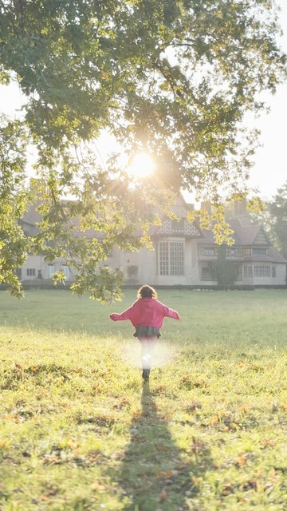
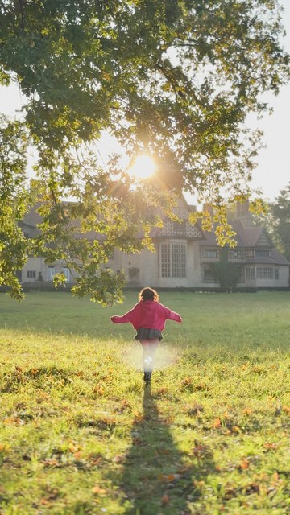
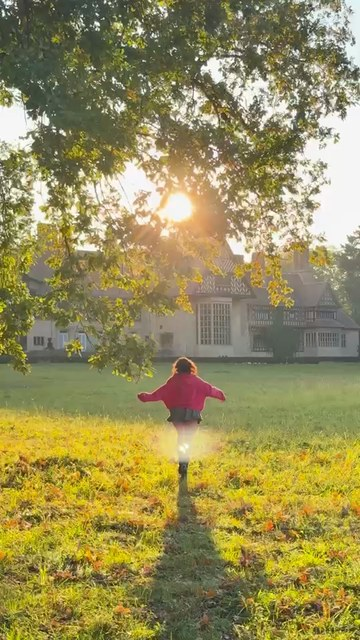
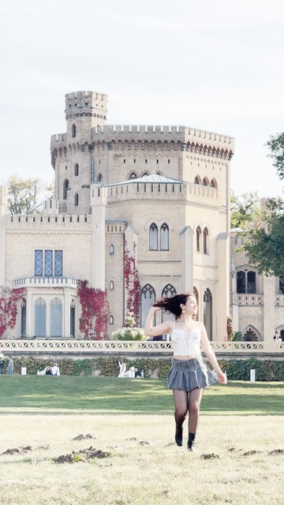
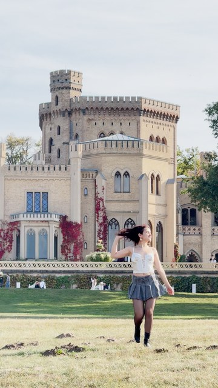
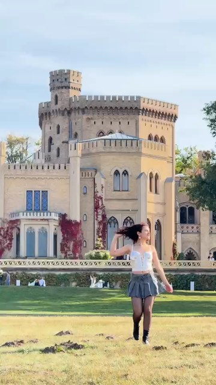
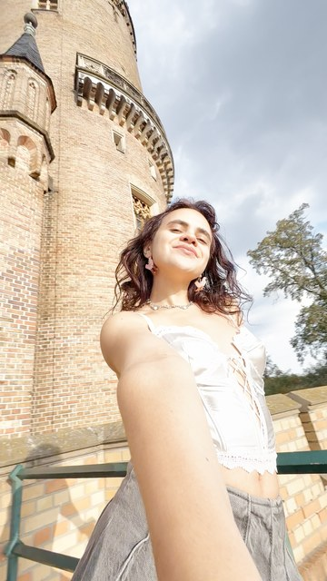
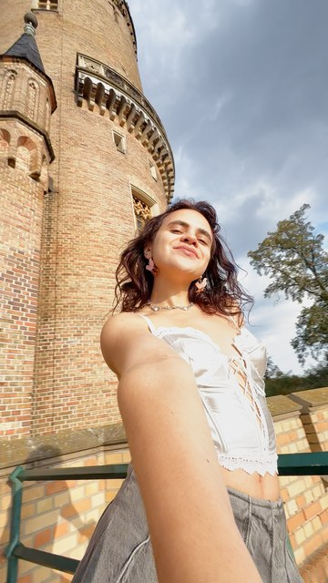
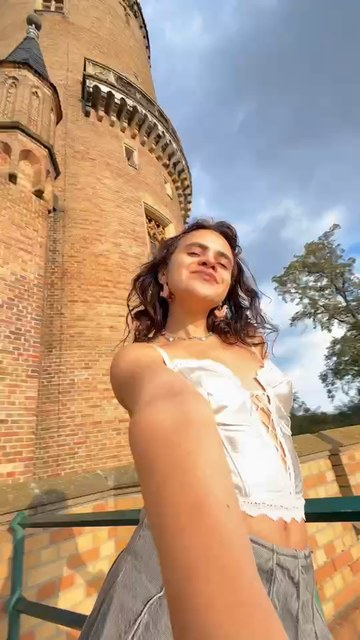
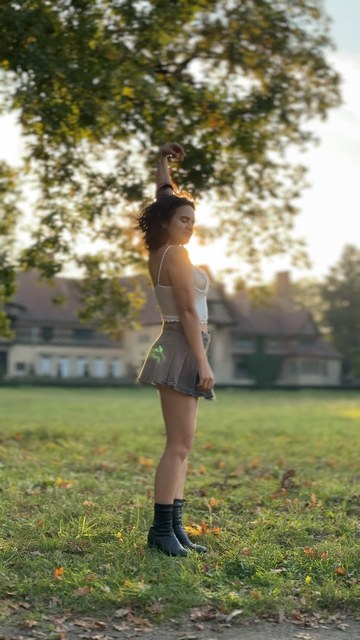

# HLG → SDR brightness in Resolve: experiment

Date: 2026-10-10, DaVinci Resolve Studio 21.1.1, project `cf-potsdam-2026-10-04-reel-test`, timeline `reel-test` (no custom timeline settings, so project changes reach it live). Walk: `~/Movies/content-factory/potsdam-2026-10-04`.

## Problem

iPhone 16 Pro HLG (Dolby Vision 8.4) clips rendered too bright, flat and washed out. The SDR iPhone 15 Pro Max clip (IMG_1621) looked right. The ffmpeg proxies (`zscale` linear → `tonemap=hable` → bt709) look natural and were used as the reference.

## Method

- Shots s01 (IMG_0493, 24 fps), s02 (IMG_0332), s03 (IMG_0378), plus all 8 shots for the final candidates.
- Each variant: set the clip `Input Color Space` on all 7 HLG clips and/or the project settings (each write read back), then `Timeline.SetCurrentTimecode` at the shot midpoint and `Project.ExportCurrentFrameAsStill` (1080×1920 PNG, after the output DRT).
- Reference: the proxy frame at the same source time (`ffmpeg -ss <t> -i proxy/<clip>.mp4 -frames:v 1`, scaled to 1080×1920). Source time = `in_s + (duration//2) × speed / 30`.
- Metrics on the 8-bit RGB PNG: mean Rec.709 luma (0–255), % pixels with luma ≥ 235 ("clip %"), and mean `max(RGB) − min(RGB)` as a rough saturation figure.
- Every PNG was also looked at next to the proxy frame.

Reference values: proxy s01 139.8 / 5.86 %, s02 151.1 / 2.23 %, s03 172.6 / 1.51 %; saturation 64 / 66 / 38.

## Results (3 shots; luma | clip %)

"in"/"out" are `inputDRT`/`outputDRT`. Unless stated, the project is `SDR 100`, in `DaVinci`, out `DaVinci`, `useInverseDRT=0`.

| variant | s01 IMG_0493 luma | ≥235 % | s02 IMG_0332 luma | ≥235 % | s03 IMG_0378 luma | ≥235 % | mean sat (s01/s02/s03) |
|---|---|---|---|---|---|---|---|
| **proxy (reference)** | 139.8 | 5.86 | 151.1 | 2.23 | 172.6 | 1.51 | 64 / 66 / 38 |
| before (auto `Rec.2100 HLG`) | 178.8 | 11.41 | 185.8 | 21.28 | 202.5 | 38.24 | 43 / 40 / 16 |
| A `Rec.2100 HLG (Scene)` | 178.8 | 11.41 | 185.8 | 21.28 | 202.5 | 38.24 | 43 / 40 / 16 |
| B `Rec.2020 HLG ARIB STD-B67` | 177.9 | 10.52 | 184.7 | 18.05 | 201.1 | 36.46 | 42 / 39 / 15 |
| C/A: A + HDR 1000 | 179.9 | 12.81 | 186.4 | 21.92 | 202.7 | 38.77 | 40 / 39 / 15 |
| C/B: B + HDR 1000 | 179.0 | 11.73 | 185.4 | 18.70 | 201.4 | 37.03 | 39 / 38 / 15 |
| D at SDR 100: B + out Luminance Mapping | 177.9 | 10.52 | 184.7 | 18.05 | 201.1 | 36.46 | 42 / 39 / 15 |
| D at SDR 100: B + out Saturation Preserving | 177.9 | 10.52 | 184.7 | 18.05 | 201.1 | 36.46 | 42 / 39 / 15 |
| D at SDR 100: B + out None | 189.0 | 12.46 | 194.7 | 24.45 | 208.9 | 40.05 | 37 / 34 / 13 |
| D at HDR 1000: C/B + out DaVinci | 179.0 | 11.73 | 185.4 | 18.70 | 201.4 | 37.03 | 39 / 38 / 15 |
| D at HDR 1000: C/B + out Luminance Mapping | 178.1 | 10.59 | 184.6 | 18.02 | 201.1 | 36.38 | 39 / 38 / 15 |
| D at HDR 1000: C/B + out Saturation Preserving | 177.6 | 9.81 | 183.3 | 17.56 | 200.8 | 35.61 | 65 / 65 / 34 |
| D at HDR 1000: C/B + out None | 214.4 | 49.84 | 217.6 | 57.86 | 230.3 | 73.35 | 51 / 36 / 9 |
| extra: B + in None (SDR 100) | 230.3 | 70.22 | 227.9 | 74.65 | 237.6 | 82.54 | 60 / 43 / 10 |
| extra: B + in Luminance Mapping (SDR 100) | 177.0 | 9.86 | 183.6 | 17.38 | 200.9 | 35.85 | 42 / 40 / 15 |
| extra: B + in Saturation Preserving (SDR 100) | 177.6 | 9.92 | 183.4 | 17.61 | 200.9 | 35.78 | 65 / 64 / 33 |
| E: B + SDR 100 + CDL −1.02 stop | 121.2 | 0.00 | 126.1 | 0.00 | 138.2 | 0.00 | 31 / 29 / 11 |
| F: C/B + CDL −0.75 stop | 154.6 | 6.20 | 162.9 | 2.12 | 181.2 | 6.00 | 42 / 40 / 17 |
| F: C/B + CDL −1.02 stop | 145.4 | 0.54 | 154.3 | 0.92 | 173.2 | 0.07 | 42 / 41 / 18 |
| F/A: C/A + CDL −1.02 stop | 146.6 | 5.52 | 155.7 | 1.48 | 175.1 | 1.94 | 43 / 41 / 18 |
| F + out Luminance Mapping | 144.7 | 0.51 | 153.6 | 0.92 | 172.9 | 0.06 | 42 / 41 / 18 |
| F + out Saturation Preserving | 144.5 | 0.48 | 153.4 | 0.90 | 172.9 | 0.06 | 60 / 61 / 34 |
| F/A + out Saturation Preserving | 145.6 | 5.41 | 154.7 | 1.43 | 174.8 | 1.73 | 61 / 63 / 36 |
| **chosen** (F + `useInverseDRT=1` + CDL sat 1.25) | 146.1 | 0.57 | 154.8 | 0.94 | 173.3 | 0.08 | 53 / 51 / 23 |

### What the numbers say

1. **No color space string or DRT choice fixes it (A–D).** `Rec.2100 HLG` and `Rec.2100 HLG (Scene)` give bit-identical stills (checked twice, also after switching back from B). B (`Rec.2020 HLG ARIB STD-B67`) is the same brightness with slightly fewer clipped pixels. `HDR 1000` working luminance, and every input/output DRT, move the mean luma by ≤ 2 levels. The DRT only shapes the top end. `None` clips hard.
2. **The cause is a one-stop offset of reference white.** Every HLG shot is 30–40 luma levels above the proxy, with shadows lifted as much as highlights (s01 0.1th percentile: 84 vs 47). Resolve 21 converts HLG per ITU-R BT.2408 (the binary carries the option text "Convert HLG and PQ using methods specified in ITU-R BT.2408-7"; it is not among the 158 keys `GetSettings()` returns). BT.2408 puts HLG reference white (75 % signal) at 203 nits. The SDR output's white is 100 nits, and no DRT rescales reference white, so diffuse white lands about 1 stop over SDR white. That gives the "bright and washed out" look.
3. **A −1.02 stop exposure (log2(203/100)) in the working space fixes the mean.** It goes in as node-1 CDL `Offset = −0.0749` (DaVinci Intermediate: 0.07329 per stop). It has to sit **before** the tone map, so the timeline must hold HDR: at `SDR 100` the input DRT has already squeezed the clip to 100 nits and the offset just greys out the highlights (E: nothing ≥ 235, dull). At `HDR 1000` the output DRT rolls the 1000-nit HLG range off after the offset (F). With F, mean luma is within 1–6 levels of the proxies on s01–s03, and highlights are not clipped (≤ 1 % ≥ 235, versus 1.5–5.9 % on the hable proxies).
4. **B over A**: once exposure is right, A clips more (s01 5.5 % ≥ 235 vs 0.5 %, s03 1.9 % vs 0.1 %) at the same mean.
5. **`HDR 1000` darkens SDR clips** unless `useInverseDRT=1`. Without it IMG_1621 drops from 123.9 to 110.4 luma, with no pixels ≥ 235. With the inverse DRT and output DRT `DaVinci`, it round-trips **bit-identically** to the old SDR 100 still (123.9 / 7.08 %, proxy 122.7 / 6.87 %). With `Saturation Preserving` the SDR clip gains saturation (35 → 44), and shots s04–s06 get 15–21 % of pixels with a channel ≥ 250 (blue sky and skin channel-clip). With `Luminance Mapping` the result is the same as `DaVinci` within 1 level.
6. **Saturation**: the DaVinci DRT leaves HLG shots at about 0.65× the proxies' saturation (the hable proxies with `desat=0` are, if anything, rich). CDL saturation 1.25 brings skin back to natural without channel clipping. 1.4 got closer to the proxy numbers but pushed skin toward orange.

### Chosen variant, all 8 shots (luma / clip %; saturation before / chosen / proxy)

| shot | before | chosen | proxy | saturation |
|---|---|---|---|---|
| s01 IMG_0493 | 178.8 / 11.41 | 146.1 / 0.57 | 139.8 / 5.86 | 43 / 53 / 64 |
| s02 IMG_0332 | 185.8 / 21.28 | 154.8 / 0.94 | 151.1 / 2.23 | 40 / 51 / 66 |
| s03 IMG_0378 | 202.5 / 38.24 | 173.3 / 0.08 | 172.6 / 1.51 | 16 / 23 / 38 |
| s04 IMG_0412 (0.5×) | 192.9 / 21.45 | 161.6 / 0.79 | 159.1 / 1.24 | 23 / 32 / 48 |
| s05 IMG_0457 | 196.0 / 18.68 | 164.9 / 3.24 | 155.3 / 4.22 | 38 / 53 / 75 |
| s06 IMG_0471 | 175.4 / 21.04 | 145.4 / 0.42 | 139.7 / 1.01 | 45 / 56 / 77 |
| s07 IMG_1621 (SDR) | 123.9 / 7.08 | 123.9 / 7.08 | 122.7 / 6.87 | 35 / 35 / 34 |
| s08 IMG_0484 | 187.8 / 21.31 | 155.4 / 0.02 | 151.0 / 9.57 | 49 / 61 / 70 |

These are the stills of the real rebuild (`python -m cf.build …/reels/reel-test`), not of the experiment timeline. They match the experiment's numbers exactly.

## Verdict

Default for every Reel:

- Project: `colorScienceMode='davinciYRGBColorManagedv2'`, `colorSpaceTimeline='DaVinci WG/Intermediate'`, `colorSpaceOutput='Rec.709 Gamma 2.4'`, `inputDRT='DaVinci'`, `outputDRT='DaVinci'`, **`timelineWorkingLuminanceMode='HDR 1000'`**, **`useInverseDRT='1'`**.
- Clip `Input Color Space`: HLG **`'Rec.2020 HLG ARIB STD-B67'`**, SDR `'Rec.709 Gamma 2.4'` (forced by cf.build; the auto-detected `'Rec.709 (Scene)'` gives identical pixels).
- Every HLG timeline item: node-1 CDL `Offset −0.0749` (−1.02 stop), `Saturation 1.25`, `Slope 1`, `Power 1` (cf.build `normalize_hlg`).

Why: it is the only variant whose mean luma is within ~6 levels of the proxies on all HLG shots (s05: +10). It clips fewer highlights than the proxies, and it leaves the SDR clip pixel-identical. The remaining gap is saturation. It is lower than the hable proxies, most in bright skies (s03: the sky stays paler than the proxy's blue). That is a Look decision, not a transform error.

## Caveats and open points

- **Node 1 is now reserved.** `ApplyGradeFromDRX` replaces the grade, so cf.build applies the HLG CDL **after** the Look. A Look DRX must keep node 1 neutral, otherwise its node-1 primaries are overwritten. The API has no `GetCDL`; the read-back is the stills' luma, which cf.build now records next to the proxy luma in `build-report.json`, with a note when they differ by more than 20.
- **The BT.2408 option was not tested.** Unticking "Convert HLG and PQ using methods specified in ITU-R BT.2408-7" in the GUI may change where Resolve puts HLG reference white and make the CDL wrong (or unnecessary). The scripting API does not expose it. Keep the default and re-run this check after any Resolve update.
- The DJI HLG profile (`hlg`) gets the same string and CDL by analogy; no Pocket HLG file was tested.
- The CDL offset is exact only on DaVinci Intermediate's log segment (above about −7 stops). Deep shadows move slightly less.

## Stills (360 px wide)

`color-hlg-experiment/`: `proxy_s0N.jpg` (reference), `before_s0N.jpg` (auto `Rec.2100 HLG`, SDR 100), `final_s0N.jpg` (chosen, from the rebuild) for all 8 shots; for s01–s03 also `B_`, `C_B_`, `D_lum_`, `D_satpres_` (HDR 1000), `F_exposure_` (C/B + −1.02 stop) and `F_exposure_satpres_`. Variant A's stills are not kept because they are identical to `before_`.

| | before | final | proxy |
|---|---|---|---|
| s01 |  |  |  |
| s03 |  |  |  |
| s05 |  |  |  |
| s07 (SDR) |  |  |  |
